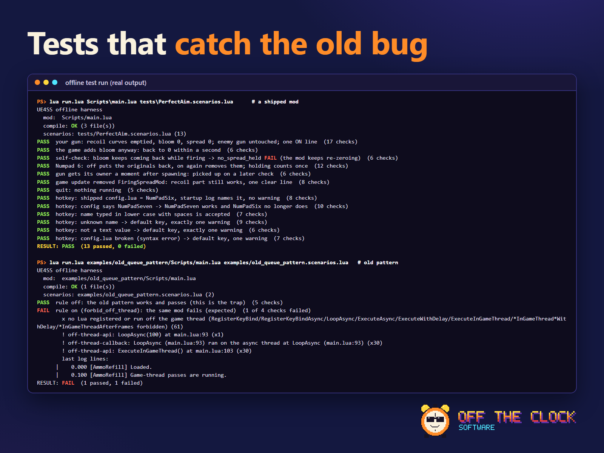

# UE4SS Mod Test Kit

**Test UE4SS Lua mods without launching the game, and write them so they don't crash.**

A free (MIT) kit for [UE4SS](https://github.com/UE4SS-RE/RE-UE4SS) Lua modders: an offline test harness, crash-safe helper libraries, a linter, a complete example mod and the lessons behind all of it. Pure Lua 5.4. No game files, no UE4SS files, no dependencies.



**What you get**
- **A test run in seconds, no game needed.** Your real `main.lua` runs against a fake UE4SS and a fake game: frames, hotkeys, world changes, quitting, a game update that renamed a function.
- **The crash patterns caught before a player sees them:** UObject access from a background thread, work that keeps running after quit, uncaught Lua errors, never-set globals, and any Lua that runs off the game thread, each with the mod's `file:line`.
- **Tests that are proven to fail.** The kit ships the broken patterns on purpose, and its own self-test (`lua test_all.lua`, also run by CI) checks that the harness and the lint reject them.
- **Drop-in helpers** for crash-safe hooks, game-thread hotkeys and mods that grade themselves in `UE4SS.log`.

Built from the crash evidence of shipping UE4SS mods for several Unreal Engine 4 and 5 games.

## The one rule

> **Don't run Lua off the game thread. Don't use `RegisterKeyBind`, `RegisterKeyBindAsync`, `LoopAsync`, `ExecuteAsync`, `ExecuteWithDelay`, `ExecuteInGameThread` or the `*InGameThread*` delayed functions, not even for a callback that only flips a flag.**
>
> Drive everything from `RegisterHook` on UFunctions the game itself calls on its game thread. Read keys in such a hook with `PlayerController:IsInputKeyDown`. Stop on `QuitGame`, re-check every object before use, and fail closed with one clear log line.

Why: a mod has one Lua state. Callbacks that UE4SS runs on its own threads (key binds, async loops, timers), or that it drains from a ProcessEvent hook on whatever thread fires it, race the same mod's game-thread hooks, which take no lock. That has crashed real games, sometimes hours after start. The evidence and the sources are in [`LESSONS.md`](LESSONS.md) and [`docs/ENGINE-BEST-PRACTICES-UE4SS.md`](docs/ENGINE-BEST-PRACTICES-UE4SS.md). Note that the official guide's examples still use key binds with `ExecuteInGameThread`, so this is a deliberate departure, not an oversight.

The kit enforces the rule: the harness fails a mod that registers or runs any off-thread Lua (with the offending `file:line`), and the lint reports each of these APIs as an error.

## What's in it

| Part | What it does |
|---|---|
| [`harness/`](harness/README.md) | **Offline test harness.** Runs your mod's real `Scripts/main.lua` against a fake UE4SS and a fake game. Catches UObject access from background threads, access after quit, uncaught Lua errors, never-set globals, compile errors, and any off-thread Lua. Simulates frames, world changes, quitting, renamed hooks and missing objects. |
| [`lib/otc_safe.lua`](lib/otc_safe.lua) | **Crash-safe helpers.** Hooks that can't throw, one "feature disabled after a game update" line instead of a crash or log spam, `IsValid`-aware finds, typed writes with read-back, a `ClientRestart` helper, game-thread-only guards. |
| [`lib/otc_keys.lua`](lib/otc_keys.lua) | **Hotkeys read on the game thread.** `IsInputKeyDown` from a per-frame hook, edge detection, key-name mapping, switches itself off with one log line if the API breaks. |
| [`lib/otc_selfcheck.lua`](lib/otc_selfcheck.lua) | **Mods that grade themselves.** Your mod writes `[SELFCHECK] <Mod> <check> PASS/FAIL` lines to `UE4SS.log` from what it actually read back from the game, so a test session ends with a result. |
| [`lint/lint.lua`](lint/lint.lua) | **Static checks.** Syntax, off-thread APIs, globals read but never set, `if obj then` after `FindFirstOf`, `type(obj.Fn) == "function"`. |
| [`examples/FasterSprint`](examples/FasterSprint/README.md) | **A complete small mod** built the crash-safe way, with its scenario file. |
| [`harness/examples/`](harness/README.md#files) | Two more small mods in the safe pattern (a per-frame worker and a hotkey mod), plus the **banned pattern kept on purpose**, which the harness and lint must reject. |
| [`LESSONS.md`](LESSONS.md) | **Lessons learned the hard way** from shipping UE4SS mods for several Unreal games: threading, hooks, arrays, loader settings, packaging, testing. |
| [`docs/`](docs/) | **Best-practice checklists with sources**: [UE4SS](docs/ENGINE-BEST-PRACTICES-UE4SS.md) (the main one) and, for Unity games, [BepInEx](docs/ENGINE-BEST-PRACTICES-BEPINEX.md). |

## Quick start

1. **Install Lua 5.4** (`lua` + `luac`):
   - Windows: `winget install -e --id DEVCOM.Lua` (reopen the terminal afterwards)
   - Linux: `sudo apt install lua5.4` · macOS: `brew install lua`
   - No Lua? `pip install lupa` and use `python harness/run_lupa.py` instead of `lua harness/run.lua`.
2. **Check the kit works** (from this folder):
   ```
   lua test_all.lua
   ```
   Expect `RESULT: PASS`. Three examples are *meant* to fail; the self-test checks that they do.
3. **Run the harness on the example mod:**
   ```
   lua harness/run.lua examples/FasterSprint/Scripts/main.lua examples/FasterSprint/tests/FasterSprint.scenarios.lua
   ```
4. **Your own mod:** copy `lib/otc_safe.lua` (and optionally `lib/otc_keys.lua` and `lib/otc_selfcheck.lua`) into your mod's `Scripts/` folder, copy a scenario file from the examples into `tests/`, change the fake objects to match your game's names, then:
   ```
   lua harness/run.lua path/to/MyMod/Scripts/main.lua path/to/MyMod/tests/MyMod.scenarios.lua
   lua lint/lint.lua path/to/MyMod
   ```
   Start every scenario setup with `H.config.forbid_off_thread = true`.

## How the offline harness works

`harness/fake_ue4ss.lua` defines the UE4SS Lua API (`RegisterHook`, `FindFirstOf`, `NotifyOnNewObject`, `UEHelpers`, `PlayerController:IsInputKeyDown`, ... and the threading APIs, so that using them is detected) and a tiny simulated engine. Fake UObjects are Lua proxies that record every read, write and call together with the **simulated thread** it happened on:

- `load`: your `main.lua` running at startup
- `game`: the game thread (hook callbacks)
- `async`: UE4SS's background thread (`LoopAsync`, `ExecuteWithDelay`, ...)
- `input`: the key-input thread (`RegisterKeyBind` callbacks)

Time moves in 25 ms frames. A scenario builds a fake world (`H.player_world`), tells the harness which UFunction the game calls every frame (`H.every_frame_hook`), drives it (`H.run`, `H.key_down`, `H.fire_hook`, `H.change_world`, `H.quit`) and asserts results (`H.eq`, `H.check`). On quit, every non-persistent object becomes invalid after two frames, exactly like dangling pointers, so a mod that keeps working past quit is caught.

After each scenario the runner adds automatic checks (no background-thread access, no access after teardown, no uncaught Lua errors, and with `forbid_off_thread` no off-thread Lua at all) and prints the mod's `file:line` for every violation. Full reference: [`harness/README.md`](harness/README.md).

**What it can't catch:** real engine behaviour (whether a UFunction exists, its real parameters, whether the game calls it through ProcessEvent), your `UE4SS-settings.ini`, native crashes and memory layout mistakes, multiplayer, and other mods. It tells you a build is worth testing in game; it doesn't replace that test.

## Layout

```
harness/        fake_ue4ss.lua, run.lua, run_lupa.py, examples/
lib/            otc_safe.lua, otc_keys.lua, otc_selfcheck.lua, tests/
lint/           lint.lua
examples/       FasterSprint/ (Scripts/, tests/)
docs/           ENGINE-BEST-PRACTICES-UE4SS.md, ENGINE-BEST-PRACTICES-BEPINEX.md, img/
test_all.lua    self-test for the whole kit (also run by CI)
LESSONS.md      the lessons behind all of this
```

## Tested with

Written against the UE4SS 3.x Lua API (Lua 5.4), and used on real mods built for UE4SS v3.0.1 Beta (git `f08dfdf`) and the upstream `2281fa31` build across several Unreal Engine 4 and 5 games. The fake API models that behaviour; if your build differs, the harness has config switches (for example `has_loop_in_game_thread`).

## Credits

- **The UE4SS team** ([RE-UE4SS](https://github.com/UE4SS-RE/RE-UE4SS), MIT). This kit only imitates the UE4SS Lua API's names so mods can run offline; it contains no UE4SS code. UE4SS is what makes Lua modding of Unreal games possible. Please support them.
- **Lua** (lua.org, MIT) and **lupa** (MIT), which you install yourself; neither is bundled.

## License

MIT. See [LICENSE](LICENSE). Use it, change it, ship it with your mods.

## Contributing and support

Bug reports, scenario ideas and new UE4SS quirks are very welcome. See [CONTRIBUTING.md](CONTRIBUTING.md). This is a free spare-time project, provided as is. If it saves you time, a star or a bug report is the best thanks.

Made by **Off the Clock Software**.
